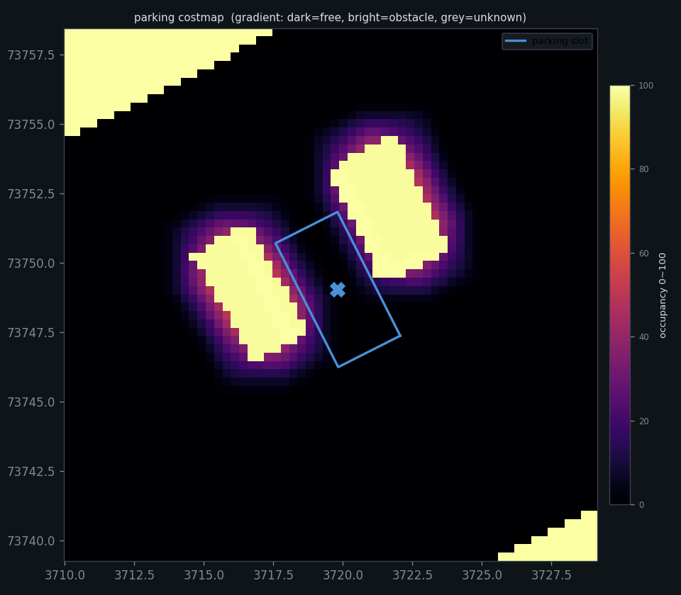

# parking_test_tools

> Autoware 泊车规划测试工具集：**一键启动、完整留证、停车原因可归因**。

整套工具**不修改 Autoware 的任何源码、launch 或参数文件**，可整体拷贝到任意车端工作空间使用。

---

## 目录

- [0. 解决什么问题](#0-解决什么问题)
- [1. 能力总览](#1-能力总览)
- [2. 环境要求](#2-环境要求)
- [3. 安装](#3-安装)
- [4. 快速开始](#4-快速开始)
- [5. 一次完整泊车测试的标准流程](#5-一次完整泊车测试的标准流程)
- [6. 三种启动方式](#6-三种启动方式)
- [7. launch 参数](#7-launch-参数)
- [8. 工具详解](#8-工具详解)
- [9. 产物说明](#9-产物说明)
- [10. 泊车状态机（原理）](#10-泊车状态机原理)
- [11. 故障排查手册](#11-故障排查手册)
- [12. 参数调优](#12-参数调优)
- [13. 依赖](#13-依赖)
- [14. 目录结构](#14-目录结构)

---

## 0. 解决什么问题

裸跑 Autoware 做泊车测试，会反复卡在四个坑上：

| 痛点 | 具体表现 | 本项目的解法 |
|---|---|---|
| **没有证据** | 终端输出关窗即丢，只剩 bag，事后无法复盘 | `run_parking.sh` 把 launch 全量输出 tee 到 `session.log`，并合并 launch 自己的日志 |
| **不知道为什么停** | 车停了，只能猜"是不是障碍""是不是规划没出来" | `watch_state.py` 按 8 级互斥判据给出**唯一原因**，并列出已排除项供核对 |
| **不知道停得准不准** | 车进了车位，但歪没歪、差多少cm说不清 | `show_parking_result.py` 把**规划终点**与**实际停车**并排对比，偏差拆成"规划偏差 + 执行偏差" |
| **现象无法定位** | "AUTO 点不动"、"设了目标没反应"，日志几十万行无从下手 | 第 11 节整理了每个现象的**确定性排查命令** |

---

## 1. 能力总览

| 能力 | 入口 | 输出 |
|---|---|---|
| 一键启动（仿真 + 录包 + 监控） | `run_parking.sh` | `session.log` / `bag/` / `evaluation.md` |
| 实时状态监控与停车归因 | `watch_state.py` | 终端滚动行 + 退出时时间线 |
| 轨迹质量评估 | `analyze_parking_session.py` | `evaluation.md`、轨迹图、CSV |
| 停车精度对比 | `show_parking_result.py` | 终端表格（✔/✘ 判定） |
| **TF 链状态检查** | `tf_monitor.py` | 连通性 / 延迟 / 频率 |
| costmap 膨胀检查 | `check_parking_costmap.py` | 统计 + 可视化 PNG |
| 当前场景查看 | `show_scenario.sh` | `Parking` / `LaneDriving` / `Empty` |
| 日志筛选 | `pick_parking_log.sh` | 只保留泊车相关行 |

---

## 2. 环境要求

| 项目 | 要求 |
|---|---|
| OS | Ubuntu 22.04 |
| ROS | Humble |
| Autoware | Universe（含 `autoware_launch`、`autoware_freespace_planner`） |
| RMW | `rmw_cyclonedds_cpp`（脚本会自动设置） |
| Python | 3.10 + `numpy` / `yaml` / `matplotlib` / `PIL` |
| 图形 | RViz 需要图形界面；无图形环境会自动降级为写日志 |

---

## 3. 安装

`ros2 launch` 只能找到**已构建并 source 过**的包，光有文件夹不行。

### 方式一：独立工作空间（推荐，不污染 Autoware）

```bash
mkdir -p ~/parking_ws/src
ln -sfn ~/zzz/parking/parking_test_tools ~/parking_ws/src/parking_test_tools
cd ~/parking_ws
source ~/autoware/install/setup.bash
colcon build --symlink-install --packages-select parking_test_tools
source install/setup.bash
```

### 方式二：装进现有 Autoware 工作空间

```bash
ln -sfn ~/zzz/parking/parking_test_tools ~/autoware/src/parking_test_tools
cd ~/autoware && colcon build --packages-select parking_test_tools
source install/setup.bash
```

之后每次新终端，两个环境都要 source：

```bash
source ~/autoware/install/setup.bash
source ~/parking_ws/install/setup.bash
```

> **改了包内文件后要重新 build**。`install(DIRECTORY)` 是复制而非软链，
> `--symlink-install` 对目录内容不生效。不过 `colcon build --packages-select parking_test_tools`
> 只要 2~3 秒，随手重跑即可。

---

## 4. 快速开始

三条命令跑通全流程：

```bash
# 1. 启动（自动加载环境、清理残留、录包、监控）
~/zzz/parking/run_parking.sh

# 2. RViz 里操作（见第 5 节）
#    2D Pose Estimate → 2D Goal Pose → 点 Autonomous

# 3. 跑完看结果
python3 ~/zzz/parking/parking_test_tools/scripts/show_parking_result.py
```

---

## 5. 一次完整泊车测试的标准流程

### Step 1 · 启动

```bash
~/zzz/parking/run_parking.sh
```

**正常表现**：

```
[DDS] 已启用 /home/cn/zzz/parking/parking_test_tools/config/cyclonedds.xml
[清理] 发现 N 个残留 Autoware 进程，先清理再启动      ← 有残留时才会出现
```

RViz 打开，地图加载，车出现在地图上。

**异常判断**：启动 40 秒内**不应出现**红字 `process has died`。如果出现，直接跳到 [11.6](#116-节点大面积-exit-code--6)。

---

### Step 2 · 设初始位姿

RViz 工具栏 → `2D Pose Estimate` → 在地图上点车的位置并拖出朝向。

**正常表现**：

```
[rviz2] Setting estimate pose: Frame:map, Position(3713.37, 73752.6, 0)
```

Localization 面板从 `Initializing` 变为 `OK`。

---

### Step 3 · 设目标

RViz 工具栏 → `2D Goal Pose` → 在**车位内**点一下并指定车头朝向。

**正常表现**：

```
[rviz2] Setting goal pose: Frame:map, Position(3719.99, 73748.4, 0)
```

规划面板从 `Waiting for Route` 变为 `Waiting for Engage`。

**注意朝向**：目标朝向必须与车位朝向一致。`angle_goal_range` 默认只有 ±1°，朝向歪 2° 就可能规划失败。

---

### Step 4 · 点 Autonomous

RViz 左侧操作面板 → `Autonomous` 按钮。

**正常表现**：`AutowareState` 从 `WAITING_FOR_ENGAGE` → `DRIVING`，车开始移动。

**点不动**（置灰）：跳到 [11.1](#111-auto-按钮点不动)。

---

### Step 5 · 观察过程

另开一个终端：

```bash
python3 ~/zzz/parking/parking_test_tools/scripts/watch_state.py --line
```

输出示例：

```
14:25:23 [行驶] DRIVING   Parking     v= 0.83 前进 段1(前进) 剩6.48m
                  pos(3717.36,73751.17) yaw62° 目标1.20m 障3.2m
14:25:26 [停车] DRIVING   Parking     v= 0.00 静止 段1(倒车) 剩0.00m
         └ ★ 段末停车：A* 第 1 段（倒车）已走到端点，末端 v=0
            分段轨迹每段末点必须停车：若随后下发反向新段 = 换向（正常揉车）
            证据(✓=成立 ✗=已排除) MRM=NORMAL ✗ | 障碍=3.2m ✗ | 分段=已到端点 ✓
```

> **段末停车是正常设计**，不是故障。详见 [第 10 节](#10-泊车状态机原理)。

---

### Step 6 · 看结果

```bash
# 终端速览（推荐）
python3 ~/zzz/parking/parking_test_tools/scripts/show_parking_result.py

# 同时打开轨迹图
python3 ~/zzz/parking/parking_test_tools/scripts/show_parking_result.py --open

# 列出最近几次会话的成绩对比
python3 ~/zzz/parking/parking_test_tools/scripts/show_parking_result.py --list
```

关键看三行：

```
  指标          规划终点    实际停车      阈值  判定
  纵向偏差        0.12 m      0.18 m      ±0.5   ✔
  横向偏差        0.05 m      0.09 m      ±0.3   ✔
  角度偏差        0.8°        1.4°          ±2   ✔
```

**规划终点 vs 实际停车**的差值就是执行偏差。差得多说明控制没跟上，调 MPC；规划本身就偏说明 A* 算歪，调 `freespace_planner`。

---

## 6. 三种启动方式

| | `run_parking.sh` | 裸 `ros2 launch` | `start_planning_sim_log.sh` |
|---|---|---|---|
| 自动 source 环境 | ✔ | ✘ | ✔ |
| 清理残留进程 | ✔ | ✘ | ✔ |
| `session.log` | ✔ | ✘ | ✔ |
| 合并 launch 自身日志 | ✔ | ✘ | ✔ |
| 去色纯文本 | ✔ | ✘ | ✔ |
| 自动录包 | ✔ | ✔ | ✔ |
| 退出后自动分析 | ✔ | ✘ | ✔ |
| 适用场景 | **日常测试** | 只看现象 | 需要完整证据链 |

### 6.1 `run_parking.sh`（推荐）

```bash
~/zzz/parking/run_parking.sh                              # 默认
~/zzz/parking/run_parking.sh map_path:=$HOME/autoware_data/maps/other-map
~/zzz/parking/run_parking.sh record_bag:=false watch_state:=false   # 只跑仿真
~/zzz/parking/run_parking.sh --log                        # 切到 shell 采集版
KEEP_ROS=1 ~/zzz/parking/run_parking.sh                   # 跳过残留清理
```

它额外做 5 件事：

1. 自动 source `~/autoware` 与 `~/parking_ws` 两个环境
2. 设置 `CYCLONEDDS_URI`（解除 participant 索引上限）
3. **自动清理残留 Autoware 进程**（避免多份并存抢 DDS 端口）
4. `ros2 launch` 输出 tee 到 `session.log`，`ROS_LOG_DIR` 指向会话目录
5. 退出后自动跑分析，出 `evaluation.md` 与图

### 6.2 裸 `ros2 launch`（只看现象）

```bash
source ~/autoware/install/setup.bash
source ~/parking_ws/install/setup.bash
ros2 launch parking_test_tools parking_test.launch.xml

# 只跑仿真，不录包不监控
ros2 launch parking_test_tools parking_sim_only.launch.xml
```

> **裸 launch 没有终端日志落盘**——ROS 2 launch 没有管道重定向机制。
> 想裸跑又要日志，只能自己接：
> ```bash
> ros2 launch parking_test_tools parking_test.launch.xml 2>&1 | tee ~/session.log
> ```
> 但这样会丢一部分 launch 内部日志，且 stdout 变管道后个别节点缓冲策略会变。
> 要完整证据还是用 `run_parking.sh`。

### 6.3 `start_planning_sim_log.sh`（完整日志采集）

```bash
~/zzz/parking/parking_test_tools/scripts/start_planning_sim_log.sh
```

和 launch 版功能相同，但额外把**终端全部输出**（含 RViz 报错、launch 参数回显、各节点 stdout）落盘，退出后自动生成轨迹图与评估报告。

开关在 `config/parking_test.conf`：

```bash
MAP_PATH=...                    # 地图
RECORD_BAG=1                    # 录包
RECORD_TF=0                     # 额外录 /tf（体积大）
RECORD_ROSOUT=1                 # 录 /rosout
WATCH_STATE=1                   # 新开终端窗口显示监控
WATCH_WAIT_SEC=300              # 等轨迹出现的上限
CHECK_ARRIVAL=1                 # 检查到达判定阈值是否过宽
```

---

## 7. launch 参数

| 参数 | 默认 | 说明 |
|---|---|---|
| `map_path` | `$HOME/autoware_data/maps/sample-map-planning` | 地图目录 |
| `vehicle_model` | `sample_vehicle` | 车型 |
| `sensor_model` | `sample_sensor_kit` | 传感器套件 |
| `record_bag` | `true` | 是否录包 |
| `watch_state` | `true` | 是否显示状态监控 |
| `record_tf` | `false` | 额外录 `/tf`、`/tf_static`（体积涨到几百 MB） |
| `log_root` | `$HOME/autoware_logs` | 日志根目录 |
| `bag_dir` | 空 | 指定 bag 输出目录；留空按时间戳自建 |

---

## 8. 工具详解

先定位脚本目录（装好后路径固定）：

```bash
export TOOLS=$(ros2 pkg prefix parking_test_tools)/share/parking_test_tools/scripts
```

> 脚本放在 `share/` 而非 `lib/`，所以**不能用 `ros2 run`**。这是有意为之：
> 脚本内部靠 `../config` 定位车位配置，装到 `lib/` 会破坏相对路径。

---

### 8.1 `watch_state.py` — 实时监控与停车归因 ★

本项目的核心工具。**不猜**：每条结论都落到具体字段值上，并列出已排除项。

```bash
python3 $TOOLS/watch_state.py              # 原地刷新
python3 $TOOLS/watch_state.py --line       # 每次一行，适合重定向到文件
python3 $TOOLS/watch_state.py --events     # 只打结论变化（最干净的时间线）
python3 $TOOLS/watch_state.py --line --explain   # 停车时列出全部检查项
```

#### 主行字段

```
09:12:20 [行驶] DRIVING  Parking  v= 0.83 前进 段1(前进) 剩6.48m pos(3717.36,73751.17) yaw62° 目标1.20m 障3.2m
```

| 字段 | 含义 |
|---|---|
| `[行驶]/[停车]/[等待]` | 运动状态 |
| `DRIVING` / `Parking` | 状态机 / 场景 |
| `v= 0.83 前进` | 带方向的车速 |
| `段1(前进) 剩6.48m` | A\* 第几段、该段方向、本段剩余长度 |
| `pos(x,y) yaw°` | 后轴中心位姿 |
| `目标1.20m` | 距 goal 直线距离 |
| `障3.2m` | 最近障碍到车体表面的估算距离 |

#### 8 级互斥归因

| 级 | 判据 | 典型结论 |
|---|---|---|
| ① | `ARRIVED_GOAL` / `is_completed` | 任务完成 |
| ② | 状态机非 DRIVING | 等待 Engage |
| ③ | MRM ≠ NORMAL / 障碍 < 1.5 m | 安全接管 |
| ④ | A\* 断供 > 8 s / 紫色有绿色无 | A\* 停止输出 / 无安全候选路径 |
| ⑤ | 轨迹起点 v=0 / 轨迹耗尽 / 段末 | 规划要求停车 |
| ⑥ | `is_stopped` / `control_cmd=0` | 控制指令为 0 |
| ⑦ | P 挡 / N 挡 | 挡位不允许 |
| ⑧ | 全部排除 | **明确写出缺哪项证据** |

退出时打印**结论变化时间线**，整场运行每次停车都在里面。

---

### 8.2 `analyze_parking_session.py` — 轨迹质量评估

```bash
source ~/autoware/install/setup.bash
python3 $TOOLS/analyze_parking_session.py <bag目录> [--out 输出目录] [--slot 车位yaml]
```

输出 `trajectory_info.json`（机器可读）、`trajectory_points.csv`、轨迹图、`evaluation.md`。

**车位来源优先级**：
1. `--slot` 指定的 yaml
2. `../config/parking_slot.yaml`
3. 都没有时用 Goal 点作车位中心 + 默认 5.0×2.5 m（报告中会标注）

---

### 8.3 `show_parking_result.py` — 停车精度速览

```bash
python3 $TOOLS/show_parking_result.py            # 默认取最近一次会话
python3 $TOOLS/show_parking_result.py <会话目录>
python3 $TOOLS/show_parking_result.py --list     # 最近几次成绩对比
python3 $TOOLS/show_parking_result.py --open     # 同时打开轨迹图
```

纯解析 `trajectory_info.json`，不连 ROS、不读 bag，秒出。

#### 输出四个区块

**① 规划结果** — 轨迹长度、前进/倒车比例、换向次数、最小转弯半径、字段填充率

**② 轨迹点字段** — `TrajectoryPoint` 全部 8 个字段的末点实测值

```
  字段                                            末点值  含义
  --------------------------------------------------------------------------------
  time_from_start                               14.799 s  相对 header.stamp 的时间偏移
  pose                        (3721.12, 73757.36, 45.6°)  map 系目标位姿
  longitudinal_velocity_mps                    0.000 m/s  目标纵向速度
  lateral_velocity_mps                         0.000 m/s  目标横向速度
  acceleration_mps2                            0.000 m/s²  纵向加速度
  heading_rate_rps                           0.000 rad/s  目标横摆角速度
  front_wheel_angle_rad                      -0.1644 rad  前轮转角
  rear_wheel_angle_rad                        0.0000 rad  后轮转角
```

**③ 停车精度** — 规划终点 vs 实际停车并排，带 ✔/✘ 判定

**④ 偏差归因** — 把总偏差拆成"规划偏差 + 执行偏差"并给调参建议

---

### 8.4 `check_parking_costmap.py` — costmap 膨胀检查

用来回答"A\* 为什么报 `Invalid start or goal pose`"、"为什么只规划到车位入口"。

```bash
source ~/autoware/install/setup.bash
python3 $TOOLS/check_parking_costmap.py --gradient --radius 5 --out ~/cm.png
```

终端打印车位中心周围 3 m 内的栅格统计（占据/空闲/未知），同时出图（占据=红、空闲=深灰、未知=黑）。



---

### 8.5 `show_scenario.sh` — 当前场景

```bash
bash $TOOLS/show_scenario.sh            # 只在场景变化时打印（推荐）
bash $TOOLS/show_scenario.sh --once     # 取一帧就退出
bash $TOOLS/show_scenario.sh --raw      # 完整消息（含 activating_scenarios）
```

---

### 8.6 `pick_parking_log.sh` — 日志筛选

```bash
bash $TOOLS/pick_parking_log.sh <日志目录>
```

从上百个节点的混杂日志里挑出泊车相关行（`freespace_planner`、`goal_planner`、`scenario_selector`）。

---

### 8.7 `wait_planning.py` — 等待规划就绪

```bash
python3 $TOOLS/wait_planning.py [超时秒数]    # 默认 300
```

满足任一条件即返回：收到点数 > 1 的轨迹，或 `/autoware/state` 进入 `PLANNING` 之后的状态。

> 为什么不用 `ros2 topic list`：`ros2` CLI 每次调用都要连 DDS daemon，
> 刚启动、节点众多时经常延迟返回。直接订阅消息最可靠。

---

### 8.8 `tf_monitor.py` — TF 链状态检查 ★

**为什么单独做一个工具**：`freespace_planner` 的 A\* 只在 costmap 坐标系里搜索，
车和 Goal 都要靠 TF 转进去。而它的 `getTransform()` 失败时**不返回错误标志**：

```cpp
TransformStamped tf;                    // 默认构造：位置全 0，四元数 w=0（非法）
try {
  tf = tf_buffer_->lookupTransform(from, to, tf2::TimePointZero, fromSec(1.0));
} catch (const tf2::TransformException & ex) {
  RCLCPP_ERROR(get_logger(), "%s", ex.what());   // 只打日志
}
return tf;                              // ← 失败也照样返回这个值
```

于是 A\* 拿着**原点附近的假位姿**去搜索，最后只报 `Can't find goal`，
真正的原因藏在上面那行 ERROR 里。这个脚本直接把 TF 状态摆出来。

```bash
source ~/autoware/install/setup.bash
python3 $TOOLS/tf_monitor.py              # 实时刷新
python3 $TOOLS/tf_monitor.py --once       # 采样 2 秒输出一次
python3 $TOOLS/tf_monitor.py --line       # 每次一行，适合写日志
python3 $TOOLS/tf_monitor.py --leaf base_footprint   # 换叶节点
python3 $TOOLS/tf_monitor.py --chain map:odom        # 额外检查指定链路
```

**DDS 会自动对齐**：脚本在 `import rclpy` 之前就会检查 `RMW_IMPLEMENTATION`，
未设置时自动改成 `rmw_cyclonedds_cpp` 并启用 `config/cyclonedds.xml`。

> 这一步很关键。直接 `python3 tf_monitor.py` 而不 source 环境时，ROS 默认用
> `rmw_fastrtps_cpp`，而 Autoware 用 `rmw_cyclonedds_cpp`——**两套完全不互通的 DDS**，
> 脚本能正常启动，但一个 TF 都收不到，`--line` 只剩下一串空时间戳。

**不写死链路结构**：不同配置的 TF 树不一样。实测 `planning_simulator` 是**直连**的：

```
map → base_link → sensor_kit_base_link → 各传感器
```

**并没有 odom 这一层**。所以脚本从 TF 树里回溯 `base_link` 的父链，实际是什么就查什么。

正常输出：

```
 TF 状态监控   11:19:14   叶节点 base_link
==============================================================================
 链路                          状态            延迟       频率   成功率  备注
 map → base_link               正常          0.3 ms    40.0 Hz     100%  规划实际使用
 ----------------------------------------------------------------------------
 TF 树：map → base_link → (2 个静态帧)
 ----------------------------------------------------------------------------
 结论：TF 链路完整，A* 可以拿到正确的起点和终点。
```

未设初始位姿时：

```
 结论：base_link 就是 TF 树的根，上面没有 map。
       说明还没有 map → base_link 这条变换，规划拿不到全局位姿。
       操作：RViz → 2D Pose Estimate，点车所在位置并拖出朝向
```

退出码：`0` = 正常，`1` = 断开（可直接用在 CI 或脚本里）。

---

## 9. 产物说明

```
~/autoware_logs/<时间戳>/
├── session.log                 # 全部终端输出
├── session_plain.log           # 去颜色码纯文本，适合 grep
├── meta.txt                    # 启动参数、起止时间、退出码
├── bag/                        # 录制的话题
├── ros_log/                    # 各节点自己的日志（ROS_LOG_DIR 已重定向）
├── evaluation.md               # 轨迹质量评估报告
├── trajectory_info.json        # 全部指标（机器可读）
├── trajectory_points.csv       # 轨迹点表格（Excel 可读）
├── trajectory_plot.png         # 车位局部轨迹图
├── plot_global.png             # 全局路线图
└── timeseries_plotjuggler.csv  # 时序数据（可直接拖进 PlotJuggler）
```

`bag/` 录制的话题（27 个），关键几类：

| 类别 | 话题 |
|---|---|
| 输入 | `/planning/mission_planning/route`、`/localization/kinematic_state`、`.../occupancy_grid`、`/planning/scenario_planning/scenario` |
| 规划输出 | `/planning/trajectory`、`.../parking/trajectory`、`.../parking/is_completed` |
| 证据 | `/control/vehicle_cmd_gate/is_stopped`、`/vehicle/status/gear_status`、`/api/motion/state` |
| 无路径证据 | `/planning/path_reference/goal_planner`（紫）、`/planning/path_candidate/goal_planner`（绿） |
| 诊断 | `/diagnostics`、`/planning/planning_validator/validation_status` |

---

## 10. 泊车状态机（原理）

泊车有**四层嵌套**的状态机，理解它们才能读懂现象。

### 第 1 层 · 全局 `AutowareState`

```
INITIALIZING(1) → WAITING_FOR_ROUTE(2) → PLANNING(3)
      → WAITING_FOR_ENGAGE(4) → DRIVING(5)
      → ARRIVED_GOAL(6) → FINALIZING(7)
```

### 第 2 层 · 场景 `Scenario`

```
Empty / LaneDriving / Parking
```

进入 `Parking` 需**同时满足 5 个条件**：

```
is_stopped && isAutonomous() && is_in_parking_lot
&& !is_goal_in_lane && 停车时长 > lane_stopping_timeout_s
```

> `is_goal_in_lane` 必须为假——目标在车道内时属于"靠边停车"（pull over），不会进 Parking。

### 第 3 层 · 泊车执行（核心，`freespace_planner`）

没有 `enum State`，但状态是显式的：

| 变量 | 含义 |
|---|---|
| `reversing_indices_` | 整条 A\* 轨迹中所有**换向点**下标 |
| `target_index_` | **当前段**的目标点（下一个换向点，或终点） |
| `is_completed_` | 终态标志 |

**换向点的判据**是相邻两点纵向速度乘积为负：

```cpp
// autoware_freespace_planner/src/autoware_freespace_planner/utils.cpp
if (points.at(i).longitudinal_velocity_mps *
    points.at(i + 1).longitudinal_velocity_mps < 0) {
  indices.push_back(i);
}
```

**状态转移只有一条规则**（`updateTargetIndex`）：

```
① 车必须停稳（is_stopped）
② 车必须到达 target_index_（is_near_target）
   ↓ 同时满足
取下一个比 target_index_ 大的换向点
   ├── 有  → target_index_ 推进到它（进入下一段）
   └── 没有 → is_completed_ = true，发布 is_completed
```

**所以"段末停车"是设计，不是故障**：状态机在等条件①成立，才能推进到下一段换挡。

重规划触发（`isPlanRequired`）：

```cpp
trajectory_.points.empty()                              // 没轨迹
|| checkCurrentTrajectoryCollision()                    // 前方有障碍且持续 > th_obstacle_time_sec
|| 偏离轨迹 > th_course_out_distance_m                  // 跑偏
```

### 第 4 层 · 目标决策（`goal_planner`）

```cpp
enum class DecisionKind { NOT_DECIDED, DECIDING, DECIDED };
```

决定"停到车位里哪个位置、什么姿态"，对应 RViz 里的紫色轨迹。

### 另：操作模式 `OperationModeState`

```
UNKNOWN(0) / STOP(1) / AUTONOMOUS(2) / LOCAL(3) / REMOTE(4)
```

`Autonomous` 按钮就作用于它。

### 完整流程串起来

```
① WAITING_FOR_ENGAGE
      ↓ 点 AUTO
② OperationMode: STOP → AUTONOMOUS
      ↓
③ DRIVING
      ↓ 开到车位附近停住，等 lane_stopping_timeout_s
④ Scenario: LaneDriving → Parking     ← 此时 A* 才启动
      ↓
⑤ 段1(前进) → 停稳 → 段2(倒车) → 停稳 → 段3(前进) → ...
      ↓ 最后一个换向点走完
⑥ is_completed = True
      ↓
⑦ ARRIVED_GOAL → FINALIZING
```

---

## 11. 故障排查手册

> **关于日志路径**：下文命令里的 `~/autoware_logs/latest` 是软链，只有
> `run_parking.sh` / `start_planning_sim_log.sh` 会更新它；用裸 `ros2 launch`
> 跑的会话不会动它，可能一直指向旧会话。需要精确指定时用：
>
> ```bash
> LOG=$(ls -1d ~/autoware_logs/20*/ | sort | tail -1)   # 最新一次会话
> grep "关键字" ${LOG}session_plain.log
> ```

### 11.1 AUTO 按钮点不动

**先查这条**（最快定位）：

```bash
ros2 node list | grep -c "^/robot_state_publisher$"
```

- 结果 **> 1** → 有残留进程，重名告警导致 `/autoware/modes/autonomous` 报 ERROR
- 结果 **= 1** → 继续往下看

确认是不是重名导致的：

```bash
ros2 topic echo /diagnostics --once | grep -A2 duplicated
```

典型输出：

```
[2] duplicated_node_checker: Error: Duplicated nodes detected[/robot_state_publisher]
```

**原因**：`robot_state_publisher` 的路径是 `/opt/ros/humble/lib/robot_state_publisher/...`，
不含 `autoware_` 前缀，按节点名前缀过滤的清理规则会一直漏掉它。每启动一次多留一个。

**解法**：重启 `run_parking.sh`（现已按完整命令行匹配，会自动清掉）。

如果干净状态下仍点不动，看诊断树：

```bash
ros2 topic echo /diagnostics --once | grep -B2 -A6 "modes/autonomous"
```

常见阻塞项：

| 阻塞项 | 原因 |
|---|---|
| `localization/state` STALE | 没设初始位姿 |
| `planning/routing/state` STALE | 没设目标 |
| `topic_rate_check/transform` STALE | TF 断链（`map` ↔ `base_link`） |
| `duplicated_node_checker` | 多份并存（见上） |

---

### 11.2 地图上有车，但设了目标没反应

**根因通常是 `mission_planner` 崩了**——你在 RViz 里的操作有人发、没人收。

```bash
grep "process has died" ~/autoware_logs/latest/session_plain.log | head
```

看到 `mission_planner`、`route_selector` 死亡 → 是 DDS participant 被占满。跳到 [11.6](#116-节点大面积-exit-code--6)。

---

### 11.3 规划不出来

```bash
grep -E "Can't find goal|Invalid start or goal pose" ~/autoware_logs/latest/session_plain.log
```

| 日志 | 原因 | 解法 |
|---|---|---|
| `Can't find goal` | 目标朝向超出 `angle_goal_range`（默认 ±1°，极严） | RViz 里把目标箭头对准车位，或调大该参数 |
| `Invalid start or goal pose` | 起点/终点落在障碍格上 | 用 `check_parking_costmap.py` 看栅格，调 `vehicle_shape_margin_m` |

---

### 11.4 车停着不动

**先查 TF**，再查别的：

```bash
python3 $TOOLS/tf_monitor.py --once
```

如果显示 `map → base_link` 断开，说明还没设初始位姿，后面所有规划都是空转
（此时日志只会报 `Can't find goal`，很容易误判成规划器参数问题）。

TF 正常的话，再用 `watch_state.py` 看结论，它会给出 8 级归因里的具体一级：

```bash
python3 $TOOLS/watch_state.py --events
```

常见：

| 结论 | 含义 | 处理 |
|---|---|---|
| `② 等待 Engage` | 路径就绪但没进自动模式 | 点 AUTO |
| `④ A* 停止输出` | 规划器卡住 | 看 `freespace_planner` 日志 |
| `⑤ 段末停车` | 换向点，正常 | 等 2 秒，会自动续下一段 |
| `⑤ 轨迹已规划但车停在起点` | 首点 v=0 | 检查 `is_start_requested` |
| `⑥ 控制指令纵向速度为 0` | 规划有速度但控制不发 | 看 `control_validator` |
| `⑦ 车辆已挂 P 挡` | 挡位不允许 | 切 D |

---

### 11.5 costmap 几乎是障碍

```bash
python3 $TOOLS/check_parking_costmap.py --gradient --radius 5 --out ~/cm.png
```

正常停车场 costmap 障碍率应在 **10~20%**。如果到 50% 以上：

`planning_simulator` 下 `launch_perception=false`，`/perception/obstacle_segmentation/pointcloud` 是空的，
`costmap_generator` 只能靠 `use_wayarea` / `use_parkinglot` / `use_objects` 填充，**非 wayarea 区域全被当成障碍**。

检查：

```bash
ros2 param get /planning/scenario_planning/parking/costmap_generator use_wayarea
ros2 param get /planning/scenario_planning/parking/costmap_generator use_parkinglot
```

---

### 11.6 节点大面积 `exit code -6`

典型日志：

```
[ERROR] [mission_planner-23]: process has died [exit code -6]
rclpy._rclpy_pybind11.RCLError: rcl node's rmw handle is invalid
Failed to find a free participant index for domain 0
```

**根因**：DDS participant 索引被占满。最常见是多份 Autoware 并存。

```bash
# 看有多少份在跑
ps -eo comm | awk '$1 ~ /^(autoware_|component_cont|robot_state_pub)/' | sort | uniq -c | sort -rn | head
```

计数出现 `2` 以上 → 有旧进程没退。

**解法**（三步，缺一不可）：

```bash
# 1. 清理进程（注意 robot_state_publisher 在 /opt/ros 下，不能只按 autoware_ 过滤）
pkill -9 -f "install/autoware_"
pkill -9 -f "rclcpp_components/component_container"
pkill -9 -f "lib/robot_state_publisher/robot_state_publisher"
pkill -9 -f "ros2 launch autoware"

# 2. 清 DDS 共享内存
rm -f /dev/shm/fastrtps_* /dev/shm/sem.fastrtps_* /dev/shm/cyclonedds_*

# 3. 确认干净（应为 0）
ps -eo args --no-headers | grep -cE "[i]nstall/autoware_|[b]in/robot_state_publisher"
```

> `run_parking.sh` 和 `start_planning_sim_log.sh` 已内置这套清理，正常使用不会踩到。
> 需要保留另一份时设 `KEEP_ROS=1`。

---

## 12. 参数调优

### 停车精度相关

| 文件 | 参数 | 作用 |
|---|---|---|
| `freespace_planner.param.yaml` | `angle_goal_range` | 终点角度容差（默认 ±1°，调大更容易规划成功） |
| | `theta_size` | 角度分辨率（120 → 3°，240 → 1.5°） |
| | `th_arrived_distance_m` | 到达目标点判定距离（影响分段推进） |
| | `th_stopped_velocity_mps` | 停稳判定速度（影响换挡快慢） |
| `mpc.param.yaml` | `extend_trajectory_for_end_yaw_control` | 终点朝向控制，停歪时优先调这个 |

### 判断该调哪个

看 `show_parking_result.py` 的【偏差归因】：

```
规划偏差 0.8° + 执行偏差 +1.4° = 实际 2.2°
```

- **执行偏差大** → 控制没跟上，调 `mpc`
- **规划偏差大** → A\* 算歪，调 `freespace_planner`

### 到达判定（容易踩的坑）

`mission_planner` 的到达判定过宽会导致"车开到目标附近就被判 ArrivedGoal，泊车轨迹来不及执行"：

```bash
grep "arrival_check" ~/autoware_logs/latest/session_plain.log
```

默认 `arrival_check_lateral_distance=1.0`、`arrival_check_longitudinal_overshoot_distance=2.0`，
建议收紧到 `0.3`。**这需要手改 Autoware 的 `planning.launch.xml`，本工具不会代改**。

---

## 13. 依赖

除 Autoware 本身外：

```bash
sudo apt install python3-numpy python3-yaml python3-matplotlib python3-pil
```

GUI 终端窗口需要 `gnome-terminal` 或 `x-terminal-emulator`（无图形环境自动降级为写日志）。

---

## 14. 目录结构

```
parking_test_tools/
├── package.xml / CMakeLists.txt
├── README.md                        # 本文档
├── launch/
│   ├── parking_test.launch.xml      # 一体化入口：仿真 + 录包 + 监控
│   └── parking_sim_only.launch.xml  # 只启仿真，用于对照排查
├── config/
│   ├── cyclonedds.xml               # DDS 配置（participant 索引上限 120）
│   ├── parking_test.conf            # shell 版的开关
│   └── parking_slot.yaml            # 车位定义（评估用）
├── docs/
│   └── costmap_example.png          # costmap 检查输出示例
└── scripts/
    ├── start_planning_sim_log.sh    # 完整日志采集版启动
    ├── watch_state.py               # ★ 实时状态监控（8 级停车归因）
    ├── analyze_parking_session.py   # 轨迹质量评估
    ├── show_parking_result.py       # 停车精度速览
    ├── tf_monitor.py                # ★ TF 链状态检查
    ├── check_parking_costmap.py     # costmap 膨胀检查
    ├── show_scenario.sh             # 查看当前场景
    ├── pick_parking_log.sh          # 日志筛选
    ├── wait_planning.py             # 等规划就绪
    ├── record_bag.sh                # 录包（launch 调用）
    ├── watch_after_ready.sh         # launch 调用：等就绪再启监控
    └── run_watch.sh                 # 新终端窗口里跑监控
```

`~/zzz/parking/` 下另有：

- `run_parking.sh` — 主入口
- `archive/` — 历史资料（开发文档、旧评估结果、截图）
- `operation.txt` — 常用命令备忘

---

## 附：轨迹点字段对照

`autoware_planning_msgs/msg/TrajectoryPoint` 共 8 个字段：

| 字段 | 含义 |
|---|---|
| `time_from_start` | 相对 `header.stamp` 的时间偏移，用于时序对齐 |
| `pose` | map 系目标位姿：`position(x,y,z)` + `orientation`（四元数） |
| `longitudinal_velocity_mps` | 目标纵向速度，控制侧最核心的跟踪量 |
| `lateral_velocity_mps` | 目标横向速度，正常行驶为 0，仅泊车等横向平移场景非零 |
| `acceleration_mps2` | 纵向加速度；按绝对运动方向增大或减小，不区分前进/倒车 |
| `heading_rate_rps` | 目标横摆角速度，作为横向控制前馈 |
| `front_wheel_angle_rad` | 前轮转角，MPC 与纯跟踪的前馈量 |
| `rear_wheel_angle_rad` | 后轮转角，普通乘用车为 0，后轮转向车型使用 |
